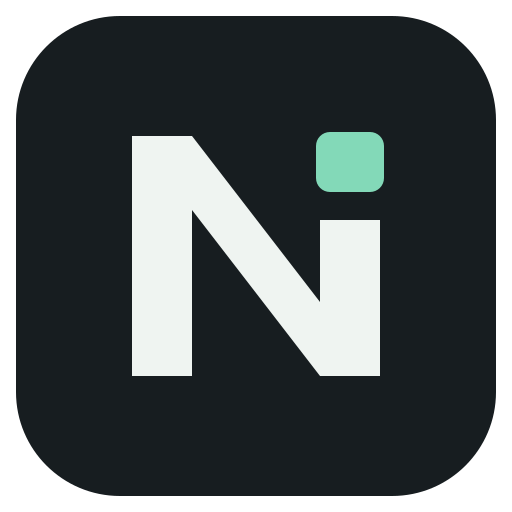

<div align="center">



# UE Node Nexus MCP

**通过 MCP 查询、编辑和验证 Unreal Engine 项目。**

*文本资产编辑，独立工作区与版本历史，语义合并，编辑器内编译与回读。*


</div>

---

## 简述

UE 材质、蓝图等资产包含大量节点、引脚和属性。传统的 MCP 逐节点读写模式会让这些结构反复以 JSON 进入模型上下文，一次编辑也可能拆成多次工具调用；图越大，上下文占用、调用开销和维护中间状态的成本越高。

因此，项目增加了 **本地解码层**：由 UE 导出真实资产结构，Python 在本地将其转换为紧凑的 `.nexus` 文本，并负责校验、计算差异和生成执行计划。AI 编辑文本，UE 应用差异、编译并回读结果，完整导出与节点映射保留在本地。MCP 仍承担调度和诊断反馈，资产编辑则通过文本差异批量提交，减少重复传输与逐项调用，也让修改可以审阅、失败可以恢复。

**0.5.0** 在解码层上加入本地协作版本库：每个 agent 使用独立工作区，暂存和提交自己的修改；发布时依据共同祖先合并当前 UE 内存状态，返回可持久保存的逐字段冲突。历史、分支、标签和回退通过同一个 `ue_sync` 入口使用。当前 UE、插件和项目的参数目录统一落入 schema，模型与校验器读取相同 JSON。

**0.6.0 / 契约 4** 增加用户级实例管理：不同工作区操作同一物理 `.uproject` 时复用编辑器，统一启动仲裁、使用租约、闲置回收和退出检查。早期 Guard 阻止普通编辑器重复启动；用户已有编辑器保留其所有权。

> [!NOTE]
> **运行环境**
>
> 当前验证平台为 Windows x64、Unreal Engine 5.5 和 Python 3.11+。MCP 服务与编辑器通过本机命名管道通信，插件需要按目标引擎版本编译。

## 功能

| 功能 | 内容 |
|:-----|:-----|
| **文本资产镜像** | Material、MaterialFunction、MaterialInstance、Blueprint、Niagara System 和属性型资产的导出、校验、差异计划与提交 |
| **场景组镜像** | 当前世界已加载 Actor、蓝图 Actor、ISM/HISM 的稳定身份、文本编辑、批量实例操作、事务和外部包保存 |
| **多 agent 协作** | 独立工作区、HEAD/index/files、三方语义合并、持久冲突会话、带 revision 条件的 UE 发布 |
| **共享编辑器生命周期** | 同项目复用、启动防重、跨会话租约、自动闲置回收、退出保护；总数量不限，启动并发与内存准入受控，用户同意后可用 `allow_low_memory` 单次越过内存准入 |
| **本地版本历史** | commit、log/show/diff/blame、branch/tag、restore/revert/reset、stash、cherry-pick/rebase/amend 和 reflog |
| **统一参数目录** | 按蓝图、材质、Niagara、场景、资产及通用类型分类的 schema JSON、Markdown 索引、定向函数与上下文查询 |
| **资产查询与管理** | 资产索引、元数据、依赖与引用关系，以及创建、复制、移动、重命名、删除和 redirector 修复 |
| **图与蓝图** | 节点、引脚、连接、变量、组件、函数，以及动画蓝图与状态机摘要 |
| **关卡操作** | Actor、变换、组件属性、材质槽、Landscape LayerInfo、关卡切换、视口相机与截图 |
| **VFX** | Niagara 发射器、模块栈、渲染器和用户参数；Cascade 系统摘要 |
| **诊断与批处理** | Blueprint/AnimBlueprint 编译与 PIE 运行时诊断、结构化 MessageLog/脚本/RHI 错误、精确实例日志、退出崩溃证据、批量执行和后台任务 |
| **独立执行验收** | 同一发布候选的高风险资产共用一份副本与一个验证编辑器，逐项编译、保存、回读并确认正常退出；支持 PIE/DX12 或 DX11 smoke |

截图通过 `viewport_capture` 显式选择 `level`、`active` 或 `pie`。完成收据记录实际渲染世界、视口类型与截图提交帧；使用 `pie` 可以独立于资产编辑器焦点核验游戏世界。

隔离副本目录可用 `UE_NEXUS_VALIDATION_DIR` 配置。容量预算包含目标卷实际分配、脏包快照与工作余量；确认结束的工程副本集中到该目录的 `.del`，回执和生命周期日志保留在原验证目录，供检查和手动删除。

七个 MCP 门面保持不变。实例管理通过 `ue_execute` 的 `bridge_instance_*` 操作提供，协作通过 `ue_sync` 扩展动作提供。内部操作默认索引不列出，仍可按名查询 schema 和调用。入口为 [operations.json](src/ue_node_nexus_mcp/operations.json)，具体定义在 [operations/](src/ue_node_nexus_mcp/operations/) 内按能力组维护。

---

## 安装

### 使用发行包

[Release 页面](https://github.com/zushinzackery2-ship-it/UE-Node-Nexus-MCP/releases) 提供已发布制品；当前工作树版本为 0.6.0。使用同一次构建的 UE 5.5 Windows x64 插件 ZIP、Python Wheel 和校验文件。关闭使用该引擎的编辑器后，将两份插件安装到 `Engine/Plugins/Marketplace/`，各工程统一加载引擎版。Bridge 包含 Core 和 Guard DLL；VFX 插件按需要启用。安装对应 Wheel：

```bat
py -3 -m venv .venv
.venv\Scripts\python.exe -m pip install ue_node_nexus_mcp-0.6.0-py3-none-any.whl
```

源码安装与构建流程如下。

### 1. 获取源码和 Python 服务

```bat
git clone https://github.com/zushinzackery2-ship-it/UE-Node-Nexus-MCP.git
cd UE-Node-Nexus-MCP
py -3 -m venv .venv
.venv\Scripts\python.exe -m pip install .
```

### 2. 编译 UE 插件

安装 Visual Studio 2022 的 C++ 游戏开发工作负载、MSVC 工具链和 Windows SDK。将 `UE_NEXUS_ENGINE_DIR` 指向本机 UE 5.5 安装目录：

```bat
set "UE_NEXUS_ENGINE_DIR=D:\Unreal\UE_5.5"
tests\compile_check\build_plugins.bat
```

脚本使用 `vswhere` 查找 Visual Studio，在 `build/validation/` 内准备精确源码副本，编译 Guard、Core、VFX 三个模块。DLL 与 `BuildIdentity.json` 位于 `build/validation/Plugins/`；身份文件记录版本、源码指纹、提交、脏状态和契约版本。

关闭使用目标引擎的编辑器，安装已经核验源码指纹和模块身份的引擎插件：

```bat
.venv\Scripts\python.exe -m tests.compile_check.install_engine --host build/validation --engine-dir "%UE_NEXUS_ENGINE_DIR%"
```

`UeNodeNexusBridge` 是必需插件；`UeNodeNexusVfxBridge` 用于 Niagara 和 Cascade。重新打开工程，在 Plugins 面板确认所需插件启用。

工程已有局部 Nexus 插件时，先对照正式交付检查全部源码，将本地扩展合入正式版，再完整备份旧插件并移出 `Plugins/` 加载目录。引擎安装器为旧引擎副本保留备份与回执。

```text
UE_5.5/Engine/Plugins/Marketplace/
├── UeNodeNexusBridge/       Core、Guard、主视口诊断
└── UeNodeNexusVfxBridge/    Niagara、Cascade
```

主视口扩展包含输入控制、状态/历史、相位截图、像素/TSR 探针及 GPU profiling，保留 `unreal.NexusViewportDiagnosticsLibrary` 的原调用。其 Renderer 私有接口适配 UE 5.5；详细契约可通过 `workflow_guide_get(category="viewport_diagnostics")` 或[接口指南](src/ue_node_nexus_mcp/guides/viewport_diagnostics.md)读取。

### 3. 配置 MCP 客户端

将下面路径替换为实际安装目录和 `.uproject`，加入客户端的 MCP 配置。多个工作区配置同一项目即可共享编辑器：

```json
{
  "mcpServers":
  {
    "ue-node-nexus":
    {
      "command": "D:/Tools/UE-Node-Nexus-MCP/.venv/Scripts/ue-node-nexus-mcp.exe",
      "args": ["--response-mode", "minimal", "--project", "D:/UEProjects/MyProject/MyProject.uproject"],
      "env":
      {
        "UE_NEXUS_TIMEOUT_SECONDS": "30"
      }
    }
  }
}
```

重连 MCP 客户端后，使用 `bridge_instance_ensure` 接入已有编辑器；明确传 `mode="reuse_or_start"` 才允许启动缺失项目。可将 [随附 Agent skill](skill/ue-node-nexus-mcp/SKILL.md) 安装到客户端的技能目录。现存旧版编辑器保持受保护状态，完成工作后再升级重启。

---

## 核心 API

| 工具 | 用途 |
|:-----|:-----|
| **`ue_context_get`** | 查看已启用能力、当前编辑器和可用实例 |
| **`ue_capability_get`** | 查询操作索引、请求 schema 或 payload 示例 |
| **`ue_execute`** | 按名称执行类型化 operation |
| **`ue_read`** | 读取资产、图、关卡、诊断等数据；大结果使用 artifact 句柄 |
| **`ue_diff_get`** | 通过 diff token 分页读取变更 |
| **`ue_plan_validate`** | 验证批量操作的参数与执行计划 |
| **`ue_sync`** | 文本工作区、暂存与历史、分支与合并、UE 发布与恢复、schema 查询 |

连接后先检查项目与桥接契约，再查询所需操作的 schema：

```text
ue_context_get(include_counts=true)
ue_execute("bridge_instance_ensure", {"mode": "reuse_or_start", "dry_run": false})
ue_execute("bridge_instance_status", {})
ue_execute("project_context_get", {}, response={"mode": "full"})
ue_execute("bridge_contract_check", {})
ue_capability_get(operation="level_actors_list", detail="schema")
```

执行的 ensure 会在编辑器启动期间挂起（`wait_seconds`，默认 45 秒），返回 `startup.outcome`：`ready` 即可工作；`waiting_for_user` 附带 `blocking_dialog`，交给用户处理后再次调用 ensure，仍是同一实例；`starting` 按 `startup.next` 再调用一次。无人可见的启动（托管、隐藏、离屏）由 Guard 确认 UE 的“驱动器空间不足”提示，并在 `dialog_notices` 报告各位置余量。结束时调用 `bridge_instance_release`。默认使用租约在 300 秒无实际工作后失效，最后一次释放后有 120 秒宽限；心跳和状态查询不会延长使用期限。其他会话、任务、未保存包和恢复事务会阻止退出。完整操作、所有权、共享仓库和升级方法见 [实例管理指南](src/ue_node_nexus_mcp/guides/instances.md)。

`ue_read(target="graph")` 读取材质图，`target="material_instance"` 读取实例参数，`target="auto"` 解析未知资产类型。操作的 `format` 控制数据形状，`response.mode` 控制响应详细程度。

`ue_read(target="diagnostics", format="detail")` 返回结构化运行时错误与编译覆盖信息；默认保留最近一次 PIE，游标只影响返回条目，累计错误数继续保留。历史日志单列，不计入当前错误数。`bridge_instance_status` 在 UE 退出后提供 fatal/ensure、转储路径与历史状态。独立执行验收通过 `safety_validate` 的 `level_open`、`runtime_smoke_start` 操作完成，要求渲染帧核验、运行时零错误和编辑器正常退出。参数与保留预算见 [诊断指南](src/ue_node_nexus_mcp/guides/diagnostics_repair.md)。

---

## 文本工作区与协作

同一工程共用 ensure 返回的镜像根与版本库，每个 agent 分别 checkout 独立工作区。新项目默认镜像位于 `<Project>/Saved/Nexus/Content_Transcoded`；编辑工具返回的 `file_paths`，然后 lint、commit、push。

```python
ue_sync("checkout", paths=["/Game/Materials"], options=dict(dry_run=False, agent_id="A"))
ue_sync("commit", options=dict(workspace_id="<id>", all=True, message="调整材质", dry_run=False))
ue_sync("push", options=dict(workspace_id="<id>", dry_run=False))
```

Schema 格式 3 在 `.nexus/schema/.objects/` 按内容共享定义，各环境保留当前索引与独立校验绑定；旧格式和历史绑定继续可读。整理镜像时保留共享对象池及引用它的历史目录。

| 指南 | 内容 |
|:-----|:-----|
| [协作入门](src/ue_node_nexus_mcp/guides/collaboration_quickstart.md) | 文本路径、动作、schema、发布验收与场景示例 |
| [完整协作契约](src/ue_node_nexus_mcp/guides/collaboration.md) | 合并、版本历史、执行回执及恢复 |
| [存储与整理](src/ue_node_nexus_mcp/guides/storage.md) | Saved/Nexus 的用途、占用来源、归档与保留规则 |

高风险候选共用一份隔离副本和一个验证编辑器，逐资产证据绑定候选及环境。结束的副本与内存基线集中到 `.del`，由用户手动删除；回执和恢复记录保留。完整流程见上述指南。

---

## 配置与排障

| 环境变量 | 默认值 | 用途 |
|:-----|:-----|:-----|
| **`UE_NEXUS_PROJECT_PATH`** | 无 | 精确项目；也可用 `--project` |
| **`UE_NEXUS_TRANSCODE_DIR`** | 已有绑定或 `<Project>/Saved/Nexus/Content_Transcoded` | 首次选择共享镜像根，冲突时返回现有位置 |
| **`UE_NEXUS_RUNTIME_DIR`** | `%LOCALAPPDATA%/UE-Node-Nexus-MCP/Runtime` | 用户级管理状态；普通工作区共用默认值 |
| **`UE_NEXUS_TIMEOUT_SECONDS`** | `30` | 桥接请求超时秒数 |
| **`UE_NEXUS_LOG_DIR`** | `%LOCALAPPDATA%/UE-Node-Nexus-MCP/Logs` | 按请求 ID 记录并轮转 Python 阶段日志 |
| **`UE_NEXUS_RESPONSE_MODE`** | `minimal` | MCP facade 返回 `minimal` 或 `full` |
| **`UE_NEXUS_FEATURES`** | 全部能力组 | 显式启用的组，逗号分隔 |
| **`UE_NEXUS_ENABLE_FEATURES`** | 空 | 追加启用的组 |
| **`UE_NEXUS_DISABLE_FEATURES`** | 空 | 禁用的组 |
| **`UE_NEXUS_VFX_SUPPORT`** | 自动探测 | `true` / `false`，VFX 能力意图 |

| 现象或错误码 | 处理 |
|:-----|:-----|
| **连接立即关闭** | 直接运行 `.venv\Scripts\ue-node-nexus-mcp.exe`；正常情况下等待 stdio 输入。出现导入错误时重新安装包，再重连客户端 |
| **`mcp_bridge_error`** | 检查编辑器进程、插件加载和实例绑定 |
| **`schema_stale`** | 执行 `ue_sync("schema")`，按新 schema 更新文本 |
| **`save_blocked_read_only`** | 先检出资产或恢复文件可写，再重试 |
| **`dependency_not_selected`** | 将所引用的本地新资产加入同一批选择 |
| **`dependency_cycle`** | 检查新资产之间的循环依赖 |
| **`sync_busy`** | 同一镜像根目录已有事务，结束后重试 |
| **`workspace_required`** | checkout 创建独立工作区，后续传 workspace_id |
| **`stale_proposal / stale_session / stale_target`** | 输入发生变化，保留原稿并重新观察、合并与预览 |
| **`identity_conflict`** | 查看相关实体与持久身份，解决会话中的身份冲突后再继续 |
| **`recovery_required`** | 按 apply_id 调用 recover 查看证据与可执行恢复动作 |
| **`bridge_contract_mismatch`** | 根据 capability 的 `build` 核对同版本 Python、Guard/Core/VFX 和 BuildId |
| **`waiting_for_user`** | 编辑器弹出的提示在等用户回答：把 `blocking_dialog` 交给用户，回答后再调用 |
| **`startup_failed / startup_timeout`** | 启动中退出或无提示停滞：查看 `exit_code`、`exited_while_waiting`、`startup_progress.last_log` 与日志 |
| **`instance_starting / instance_unresponsive`** | 查询既有实例状态和日志，保留同一项目绑定 |
| **`ambiguous_class / ambiguous_function`** | 同名类或函数（如两个文件夹里的 `BP_Light_C`）：按诊断给出的候选写完整路径 |
| **`capacity_exceeded`** | 查看并发启动数及所需/可用内存；内存不足且用户同意时，ensure 加 `allow_low_memory=true` 启动本次编辑器，启动并发限制不变；编辑器总数量不限 |
| **`manager_outdated`** | 运行中的生命周期 manager 早于所需选项；其托管编辑器退出且没有会话使用后，会按已安装版本重启 |
| **`repository_mismatch`** | 接入返回的共享仓库，保留已有历史 |
| **操作与 schema 对不上** | 同步更新 Python 服务与 UE 插件，重启编辑器并重连客户端 |

编译入口共用编译服务，成功状态包含目标 shader 和 RHI 资源更新完成信息。诊断仅检查已加载对象；保存监听在事务结束后处理队列。镜像事务跨线程、跨进程互斥，场景回读用请求标识匹配提交。上述机制约束桥接生命周期；引擎断言和 GPU 驱动故障仍属于同进程故障边界，详见 [诊断指南](src/ue_node_nexus_mcp/guides/diagnostics_repair.md)。

---

## 目录与开发

```text
UE-Node-Nexus-MCP/
├── Plugins/                 Guard、Core、VFX 原生模块
├── src/ue_node_nexus_mcp/    门面、实例、诊断、隔离与文本协作
├── tests/                   单元、编译、性能与独立 UE 验收
├── skill/                   随包 Agent skill
└── release/                 身份核验、打包与安装说明
```

[开发指南](release/DEVELOPMENT.md)提供模块目录、完整构建与测试命令、回执位置和测试范围。源码与文档按模块组织；构建产物、项目资产和本地验收记录独立保留。

## 支持边界

| 项目 | 当前范围 |
|:-----|:-----|
| **引擎版本** | 已验证 UE 5.5；其他版本需重新构建和验证 API |
| **场景范围** | 当前世界已加载对象，包括隐藏子关卡；Level Instance/Packed Level Actor、Foliage/PCG 和自动加载分区另需专用支持 |
| **构造脚本** | 构造脚本生成的组件和实例数组按只读边界导出；先完成 Actor 构造，再应用可编辑组件覆盖 |
| **Niagara** | emitter 资产、动态或链接输入、Event / Stage 栈按只读内容保留；模块重排序尚未实现 |
| **Blueprint** | ParentClass 仅用于新建；继承组件属性、宏、委托与接口存在只读边界 |
| **不透明节点** | `@opaque` 内容支持保留、移动、删除与连接，不能任意改写内部数据 |
| **批次原子性** | 每个资产单独事务；多资产批次可能部分完成，以返回诊断与同步状态为准 |
| **版本库范围** | 同机多 MCP 进程共享本地仓库；远程传输和 Git CLI 互操作独立规划 |

源码按 [MIT License](LICENSE) 发布。Unreal Engine 及其工具链遵循 Epic Games 的许可条款。

---

<div align="center">

**平台:** Windows x64 | **引擎:** Unreal Engine 5.5 | **许可证:** MIT

</div>
